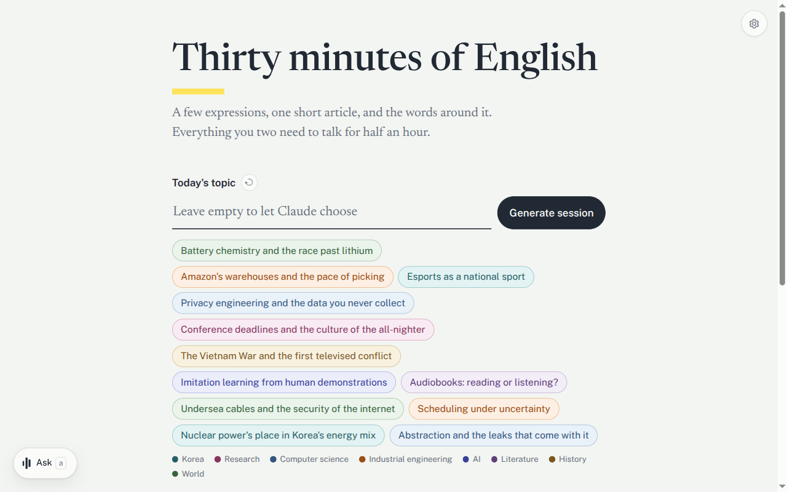
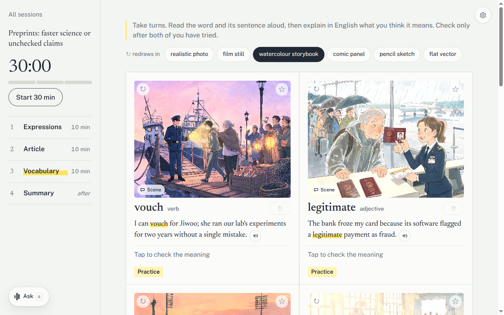

# thirty-minutes-english

Thirty minutes of English speaking practice for two people, a new session every day. Claude writes each session.



## Session

| Part | Time | What you do |
|---|---|---|
| Expressions | 10 min | Read 5 expressions aloud, then make one sentence each |
| Article | 10 min | Read a short article, summarize it, discuss 3 questions |
| Vocabulary | 10 min | Explain 10 words in English, then check the meaning |
| Summary | after | Review your notes, starred items, your sentences, and corrections |

Press `Start 30 min` and the tabs move on every 10 minutes.

## Features

- 📰 **Fresh sessions**: Claude searches the web and writes expressions, an article, and words on your topic. It skips items from recent sessions.
- 🎙️ **Voice coaches**: Read aloud marks mispronounced words. Practice fixes your sentences.
- 🖼️ **Word pictures**: each word gets a picture in the style you pick.
- 🇰🇷 **Korean hints**: one tap shows the Korean meaning or a translation of the article.
- 📝 **Notes**: a notepad under the tabs, open on every part. It saves as you type.
- ⭐ **Summary**: your notes and everything you starred, said, or got corrected, on one page.



## Quick start

Requires Docker and a Claude subscription.

```sh
cp .env.example .env               # set CLAUDE_CODE_OAUTH_TOKEN (from `claude setup-token`)
docker compose up -d --build
```

Open http://localhost:5173.

## API keys

Only the Claude token is required. Add the other keys in the app's ⚙ settings to turn on more features.

| Key | Turns on |
|---|---|
| `CLAUDE_CODE_OAUTH_TOKEN` | Session generation (required) |
| `GEMINI_API_KEY` | Voice coaches, sentences read aloud, and Summarize (writes down what you say, English or Korean only) |
| `AZURE_SPEECH_KEY` | Read aloud pronunciation check |
| `OPENROUTER_API_KEY` | Word pictures |
| `FIRECRAWL_API_KEY` | Faster web search (works without it, rate-limited) |

## Server

The same stack runs on any Linux server with Docker. It listens on the server's `127.0.0.1:5173` only, so put your own HTTPS proxy or tunnel in front. The microphone needs HTTPS.

```sh
git clone https://github.com/Cotidie/thirty-minutes-english && cd thirty-minutes-english
cp .env.example .env               # set CLAUDE_CODE_OAUTH_TOKEN, and UID=$(id -u) if it is not 1000
mkdir -p backend/data              # otherwise Docker creates it owned by root
docker compose up -d --build
```

From your own machine:

```sh
scripts/deploy user@host           # pull main on the server, rebuild, check that it answers
scripts/backup user@host           # copy the database and pictures into backups/
```

The app has no login yet. Anyone who reaches the address can generate sessions on your Claude subscription, delete them, and change the settings.

## Versioning

Versions start at 0.3.0. Every merge into `main` bumps the patch; minor and major move only when the owner decides. `scripts/bump-version patch|minor|major` updates both packages, commits, and tags `vX.Y.Z`. The version shows in the Settings modal.

## License

[MIT](LICENSE)
