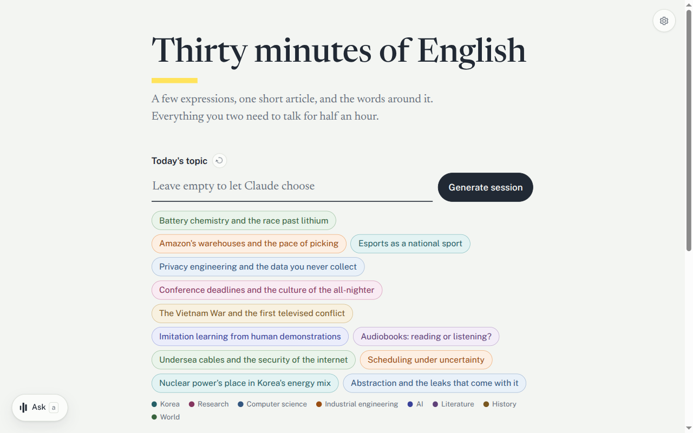
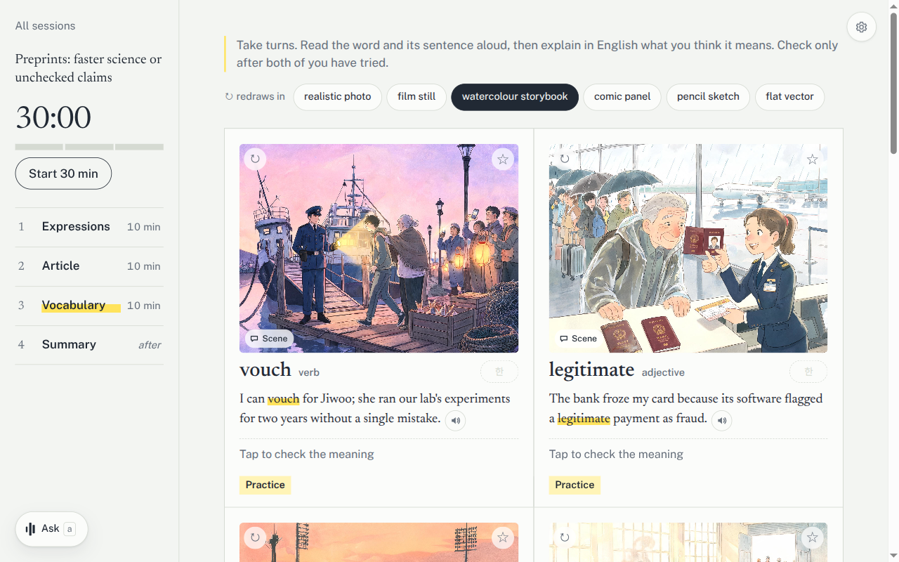

# thirty-minutes-english

Thirty minutes of English speaking practice for two people, a new session every day. Claude writes each session.



## Session

| Part | Time | What you do |
|---|---|---|
| Expressions | 10 min | Read 5 expressions aloud, then make one sentence each |
| Article | 10 min | Read a short article, summarize it, discuss 3 questions |
| Vocabulary | 10 min | Explain 8 words in English, then check the meaning |
| Summary | after | Review your notes, starred items, your sentences, and corrections |

Press `Start 30 min` and the tabs move on every 10 minutes.

## Features

- 📰 **Fresh sessions**: Claude searches the web and writes expressions, an article, and words on your topic. It skips items from recent sessions.
- 🎙️ **Voice coaches**: Read aloud marks mispronounced words. Practice fixes your sentences.
- 🖼️ **Word pictures**: each word gets a picture in the style you pick.
- 🇰🇷 **Korean hints**: one tap shows the Korean meaning or a translation of the article.
- 📝 **Notes**: a notepad under the tabs, open on every part. It saves as you type.
- ⭐ **Summary**: your notes and everything you starred, said, or got corrected, on one page.



## Quick start

Requires Docker and a Claude subscription.

```sh
cp .env.example .env               # set CLAUDE_CODE_OAUTH_TOKEN (from `claude setup-token`)
docker compose up -d --build
```

Open http://localhost:5173.

## API keys

Only the Claude token is required. Add the other keys in the app's ⚙ settings to turn on more features.

| Key | Turns on |
|---|---|
| `CLAUDE_CODE_OAUTH_TOKEN` | Session generation (required) |
| `GEMINI_API_KEY` | Voice coaches, sentences read aloud, and Summarize (writes down what you say, English or Korean only) |
| `AZURE_SPEECH_KEY` | Read aloud pronunciation check |
| `OPENROUTER_API_KEY` | Word pictures |
| `FIRECRAWL_API_KEY` | Faster web search (works without it, rate-limited) |

## Server

The same stack runs on any Linux server with Docker. It listens on port 5173 on every address of the server, in plain HTTP, and Docker's published ports skip `ufw`. Put your own HTTPS proxy or tunnel in front: the login cookie and the microphone need HTTPS.

```sh
git clone https://github.com/Cotidie/thirty-minutes-english && cd thirty-minutes-english
cp .env.example .env               # set CLAUDE_CODE_OAUTH_TOKEN, and UID=$(id -u) if it is not 1000
mkdir -p backend/data              # otherwise Docker creates it owned by root
docker compose up -d --build
```

To update, run `git pull && docker compose up -d --build` on the server.

To copy the server's database and pictures into `backups/` on your own machine:

```sh
scripts/backup user@host
```

## Same Wi-Fi

Browsers allow the microphone only over HTTPS or on `localhost`. To use it from other devices on the same Wi-Fi or hotspot, add this line to `.env`:

```sh
COMPOSE_FILE=compose.yaml:compose.lan.yaml
```

Run `docker compose up -d` and open `https://<this machine's IP>:5443`. The certificate is self-signed, so the browser shows a warning you have to click through. Traffic is encrypted, but the browser cannot confirm which machine it reached, so use this on a network you trust. A public server does not need it: its own proxy gives HTTPS.

## Accounts

Everything but signing up and logging in needs an account. Set `ADMIN_EMAIL` and `ADMIN_PASSWORD` in `.env` before the first start: that account becomes the admin, and every session from before accounts becomes theirs. Without them the app runs with no admin, and those sessions stay hidden until the values are set and the app restarts.

Anyone can sign up, with an email, a username and a password. The email logs in and only its owner and the admin see it; everyone else knows the account by its username, which its owner can change from the name button in the top corner. Emails are never checked, so a new account can do nothing that costs money until something is given to it:

- The admin gives an account credits on the Database page, under Accounts. Whatever costs money takes a fixed price from the balance of whoever uses it: making a session, drawing a picture again, Practice, Summarize, Read aloud, and hearing a sentence not read before. The admin is not charged. The prices are in `backend/app/credits.py`. A feature that fails or does not finish costs nothing. A session its maker cancels after generation began costs half, and is deleted.
- Whoever made a session shares it by typing a few letters of someone's username and picking them. The people it is shared with can use it fully, but only its maker can delete it. Their usernames label their cursors while they are in the session together.

To change the admin's password, put the new one in `ADMIN_PASSWORD` and run `docker compose up -d`. That logs the admin out everywhere. A blank value keeps the current password.

To replace anyone else's forgotten password, run this on the server. It prints a new password once and logs that account out everywhere:

```sh
docker compose exec backend uv run --no-dev python -m app.accounts.reset_password EMAIL
```

The login cookie is sent over HTTPS only, and browsers treat `localhost` as secure too. To reach the app over plain HTTP at any other address, set `COOKIE_SECURE=false`.

## Versioning

Versions start at 0.3.0. Every merge into `main` bumps the patch; minor and major move only when the owner decides. `scripts/bump-version patch|minor|major` updates both packages, commits, and tags `vX.Y.Z`. The version shows in the Settings modal.

## License

[MIT](LICENSE)
